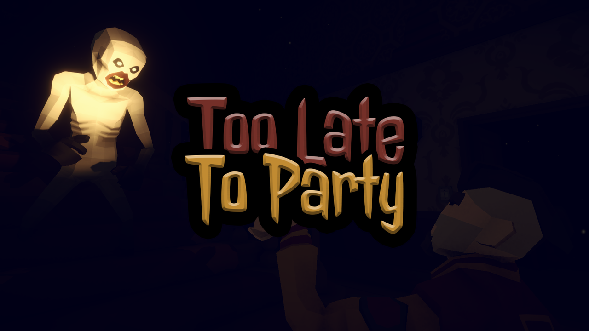
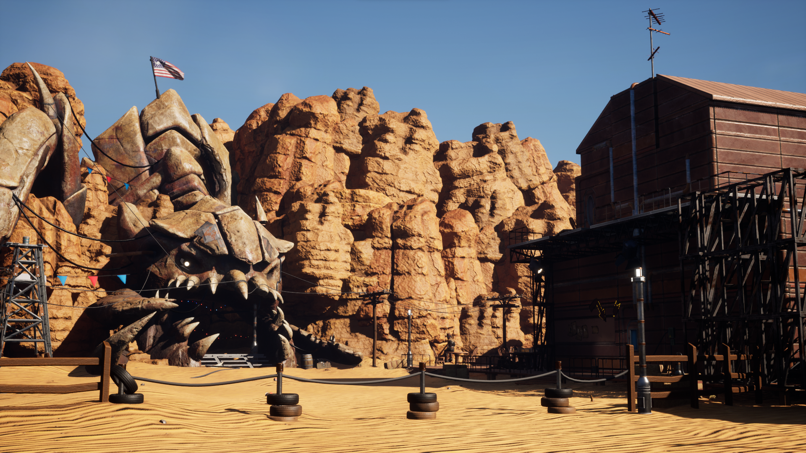
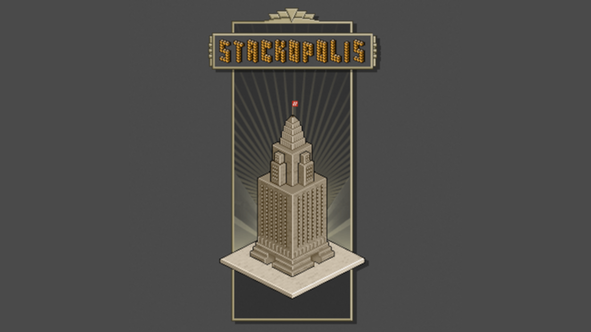
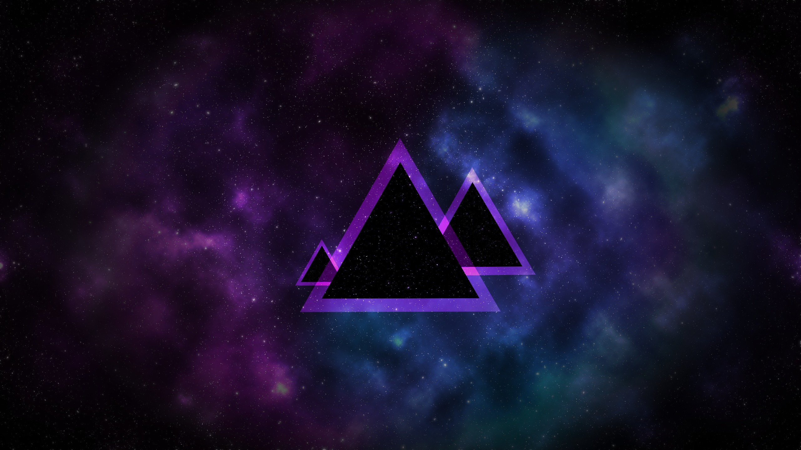
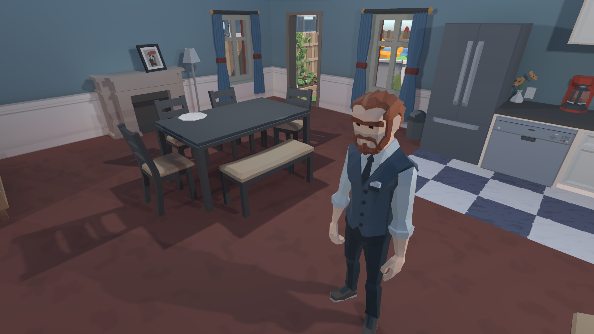

The "AI" referenced in these projects refers strictly to game AI systems (behavior trees, state machines, pathfinding, ...) not generative AI or LLMs.

 

## [Too Late To Party](https://tequiloutre.itch.io/too-late-to-party)
- ### Prototype game made for [Synty Spooky Jam 2026](https://itch.io/jam/synty-spooky-jam-oct26)
- ### Survival Horror  
 
#### ``Game Design`` ``Level Design`` ``Sound Design`` ``Core Framework``  
#### ``3C`` ``Gameplay`` ``Animation`` ``AI Behaviour`` ``UI``
 

---

## [Dust & Aliens](/projects/dust-and-aliens)
- ### School project
- ### Roguelite Fast FPS
- ### Futuristic Western
 
#### ``3C`` ``Steam Integration`` ``Tutorial``
 

---

## [Stackopolis Remake](/projects/stackopolis)
- ### Remake of an old flash game
- ### Puzzle game
  
#### ``Core Framework`` ``Gameplay`` ``UI`` ``Editor``
 

---

## [UnityTools](/projects/unity-tools)
- ### Useful tools for Unity Engine
	- Preview generator
	- EditCondition
	- SerializableDictionary
   
#### ``Editor`` ``Tools``
 

---

## [Hacknet Remake](/projects/hacknet)
- ### C++ native remake of the game Hacknet
   
#### ``C++`` ``Command interpretation`` ``File system``
 

---

## [AI Sorter](/projects/ai-sorter)
- ### A simple AI character that throw away garbages
   
#### ``AI Behaviour`` ``Animation`` ``UI``
 
