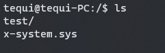
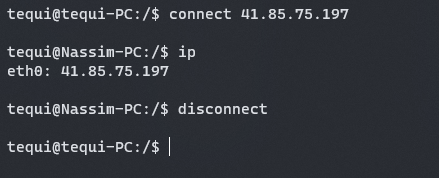
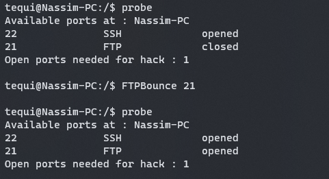
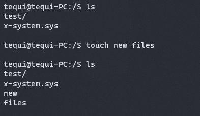

## Resume
Hacknet is a hacking simulation game where the player uses a terminal and types commands to access computers and servers.

<iframe width="640" height="360" src="https://www.youtube.com/embed/FgDmU7Pb96Y"></iframe>

The idea here was to recreate only the terminal system of the game in C++.  
This means :
- Input commands
- Interpret commands to do something
- Node & Network system
- Filesystems (files & folders)

[📥Source code](https://github.com/Tequiloutre/Hacknet/tree/inputs/Source)

 

 

## Screenshots
Here you can see examples of available commands :

| {: .shadow .rounded-10 w='600' h='281' } | {: .shadow .rounded-10 w='600' h='281' } |

| {: .shadow .rounded-10 w='600' h='281' } | {: .shadow .rounded-10 w='600' h='281' } |
