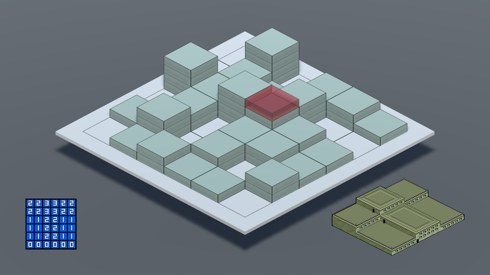
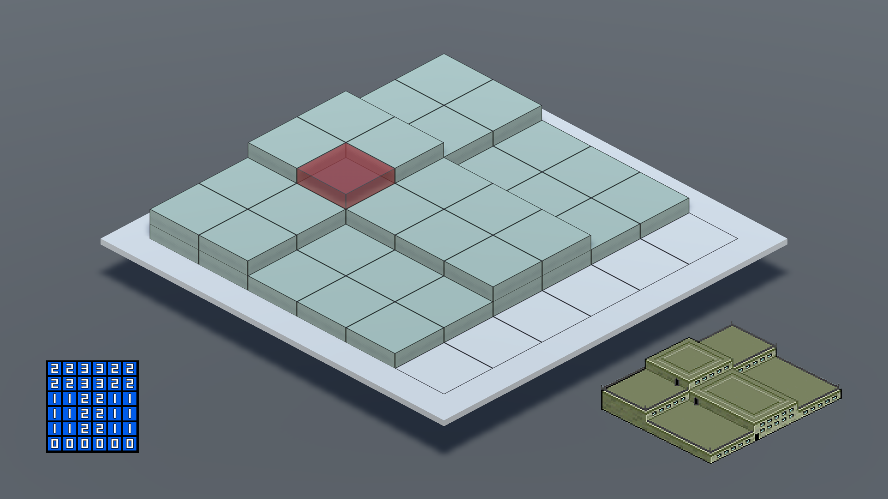
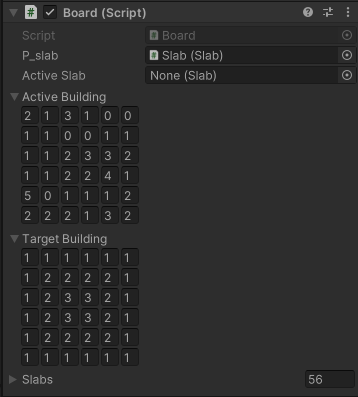
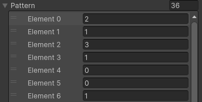
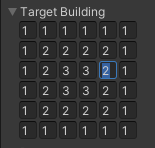
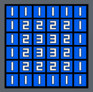
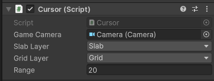

## Resume

Stackopolis is an old flash game where the player needs to build buildings by stacking blocks.

The player can click on the blocks to move them one by one.

 

The goal is to stack the blocks following the pattern on the bottom left of the screen.

The time is very limited so the player needs to be quick and be careful because the blocks hidden behind others are unreachable.

 

I wanted to create a remake of this game because I've played it a lot when I was a child and now the game isn't officialy maintained and is only playable on some old flash games websites.

It was also a good opportunity to create gameplay based on mouse input and raycasts.

 

 

## Gameplay

<video width="640" height="360" controls>
    <source src="/projects/stackopolis/gameplay.mp4" type="video/mp4">
</video>

 

 

## Development

### Board

The base gameplay isn't very complicated. Every levels have an initial building and a target building.

A building is made of a array of number that corresponds to the number of blocks needed in every slot.

When the player start a level, the board fills itself with the initial building placements and check how many slots have the right block count.

When the player moves a block, the board checks only the slot where the block comes from and the slot where it has gone, to avoid checking every slots that haven't moved.

When the invalid slot count is at 0, the building is valid and the level is won.

 

### Editor

In code, the pattern of a building is a simple array of number `int[]` which isn't very practical to edit in Unity.

 

This is why I created an editor so the pattern is exactly has seen in the game and it is more readable and editable.

   

### Cursor

To check what the player wants to do, I use a manager called Cursor.

The cursor simply does raycasts searching first for a block *(slab)* or the ground *(grid)* if no block is found.

Then it triggers events that says if the player has clicked on a block or on the ground and where.

The board then use this information to grab or place a block if one is already held.